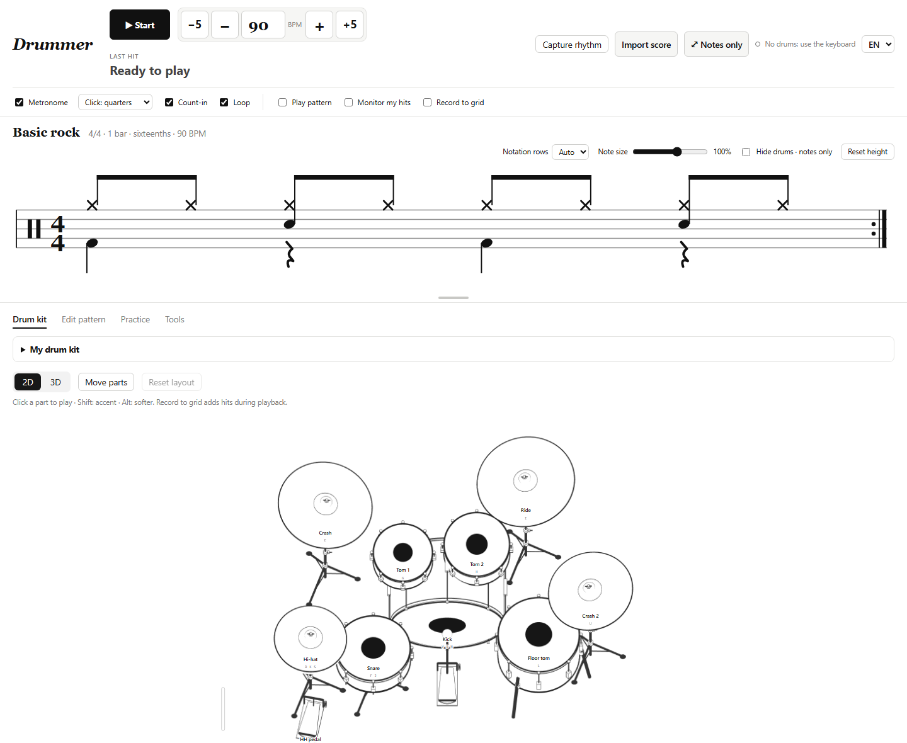
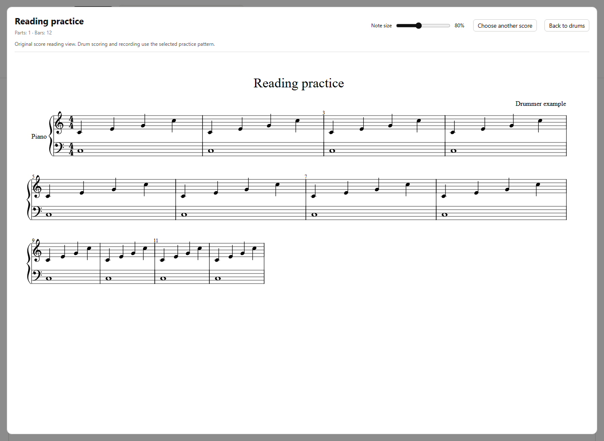
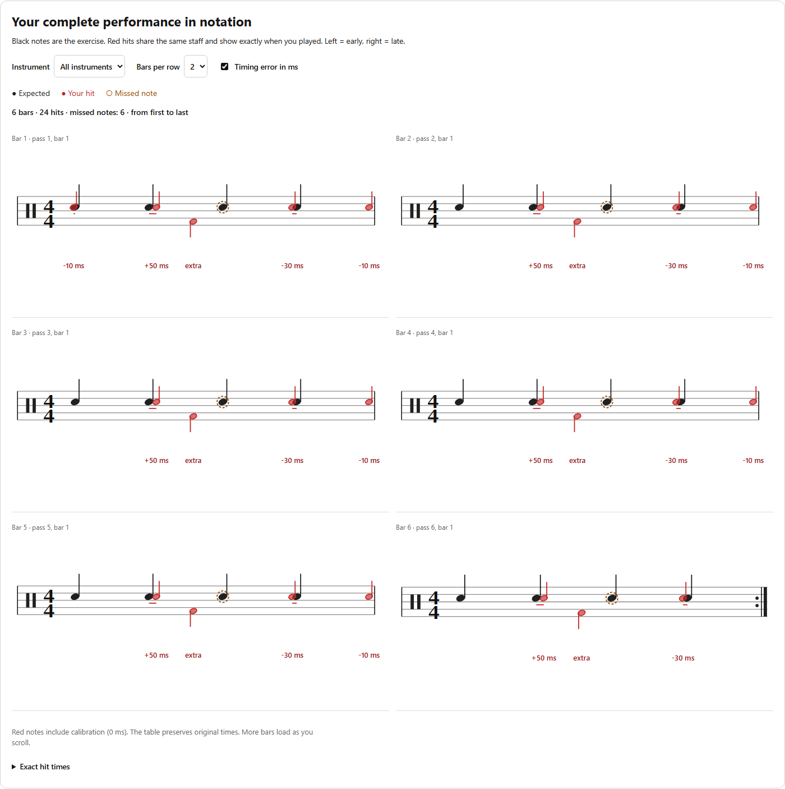

# Drummer

[**Try the live demo**](https://vladimirperovic.github.io/Drummer/) · [Guide](README.en.md) · [Report an issue](https://github.com/vladimirperovic/Drummer/issues)

Practice drums in your browser with readable notation, MIDI input and honest timing feedback. Drummer works with electronic drum kits such as the Roland TD-17, or with your keyboard and mouse. No account or application server is required.



## What you can do

- Browse 94 practice patterns, 20 per page, with previews of their actual notes.
- Edit with undo/redo, copy selected bars, and generate rudiments or fills.
- Connect multiple MIDI kits with device/channel/note rules and independent output maps, saved in profiles.
- Adjust tempo with large ±1/±5 controls and read hit feedback beside the tempo.
- Resize the notes, choose up to eight rows, or hide the drum kit for a dedicated reading view.
- Import original MusicXML scores with **Import score**. Pitched scores keep their original notation.
- Review each practice session with expected black notes and your actual red hits, including exact early/late offsets.
- Use A–B focus, a tempo trainer, backing audio, practice programs and performance replay.
- Sequence whole-song arrangements with section lengths, tempo and meter changes.
- Capture a played rhythm with count-in, quantize it, listen and save it.
- Export and restore a full backup with a change preview and conflict choices.
- Customize a 2D/3D kit, play its pads with the mouse and arrange its parts.
- Install the offline app, print practice sheets, and export patterns or performances.

The first visit opens in English. Choose **SR** at the top right for Serbian; your choice is remembered.

## Quick start

Open the [demo](https://vladimirperovic.github.io/Drummer/) in Chrome, Edge or Brave, click **Start**, and play with the keyboard. Enable **Play pattern** to hear the reference rhythm. For an electronic kit, connect USB and grant the browser's MIDI permission.

| Control | Action |
| --- | --- |
| Space | Start / stop |
| F / J | Snare |
| V / B / N | Kick |
| D / K | Closed hi-hat |
| S / A | Open hi-hat / hi-hat pedal |
| G / H / L | Toms |
| E / U / I / O | Crashes / ride / bell |
| Shift / Alt + drum key | Accent / ghost note |
| ↑ / ↓; Shift + ↑ / ↓ | Tempo ±1 / ±5 BPM |

The full keyboard map adapts to the configured kit. **My sound** enables local monitoring; disable it when your drum module already makes sound.

## Import a song as sheet music

Use **Import score** for `.musicxml`, `.xml` or compressed `.mxl` files. For a piece such as Mozart's Turkish March, export MusicXML from a notation program and select that file. The reading view shows the original pitches, parts, clefs and measures, with a zoom slider and scrolling.

| File | Purpose in Drummer |
| --- | --- |
| `.musicxml`, `.xml`, `.mxl` | Original score reading view, including pitched music |
| `.mid`, `.midi` | Tools → MIDI import: choose and map a percussion section into the rhythm editor |
| Pattern `.json` | Import/export editable Drummer rhythms |
| Audio, e.g. `.mp3`, `.wav` | Practice → Backing track: local audio accompaniment |

MusicXML viewing does not turn piano music into a drum exercise or assess pitched playing. PDF/images need conversion in a notation/OCR program first; native MuseScore/Guitar Pro files should be exported as MusicXML. Imported scores remain local and are selected again after reload. See [format notes](docs/score-formats.md).



## AI audio: drums and drum notes

Open **Tools → AI audio** and choose an MP3 or another browser-decodable audio file, up to 100 MB / 10 minutes. **Isolate drums** runs Demucs locally, with drums-only listening, a mix without drums, and WAV export. **Transcribe notes** runs ADTOF on the original mix or extracted drums. Review the estimated tempo, five instrument groups and note suggestions, then export MIDI or apply a whole-song practice reference.

The first action explicitly downloads the selected model and a shared runtime: approximately **180.5 MB for Demucs** or **17.0 MB for ADTOF**; the 14.85 MB runtime is shared. Verified files are cached for reuse and can be deleted in the AI panel. Audio is never uploaded. Processing uses CPU/WASM workers, can take several minutes and substantial memory, and can be cancelled. Transcription is approximate: toms, hi-hat articulations and cymbal types are grouped, and MIDI velocity is a default rather than detected dynamics.

ADTOF's model is **CC BY-NC-SA 4.0, non-commercial use only**. This is separate from Drummer's MIT code license; see [model notices](THIRD_PARTY_NOTICES.md).

## Read your timing

After Stop, the journal opens your notation report. Black notes show the task; red notes below show when you actually played. A red note to the left is early, to the right is late. The report includes ±milliseconds, extra hits and missed notes, plus a pass/bar selector and exact original timestamps.



## Run locally

```sh
git clone https://github.com/vladimirperovic/Drummer.git
cd Drummer
python -m http.server 8123 --bind 127.0.0.1
```

Open [127.0.0.1:8123](http://127.0.0.1:8123/). On macOS/Linux use `python3` if needed; macOS also has `pokreni.command`. Opening `index.html` directly is not supported because the app uses ES modules and a service worker.

For Web MIDI, use a supported Chromium browser over HTTPS or localhost. Keyboard/mouse practice works without a MIDI device. 2D works without WebGL.

## Local data and offline use

Patterns, sessions and settings belong to the browser and origin. The public demo and localhost have separate data. **Tools → Backup and restore** exports patterns, full sessions, programs, profiles, favorites, arrangements and settings. Review merge/replace choices and conflicts before applying a restore. Audio files and downloaded AI models are not included. The journal stores recordings in IndexedDB and loads details on demand; storage failures still show export/retry actions.

Open Tools → Offline app and wait until it is ready before going offline. AI needs its optional downloads before offline use. See [privacy](PRIVACY.md).

## Development and deployment

```sh
npm ci --prefix qa
npm --prefix qa test
python -m unittest discover -s qa -p test_analysis.py -v
```

Browser tests, implementation notes and contribution steps are in [CONTRIBUTING.md](CONTRIBUTING.md) and [qa/README.md](qa/README.md). `node alati/build-pages.mjs` prepares a static `dist/`; GitHub Actions publishes it to Pages on pushes to `main`.

Automated tests use simulated MIDI and isolated browsers. Physical drum hardware, audio-interface latency and all GPU/browser combinations have not been exhaustively tested. See [release notes](CHANGELOG.md).

See the [verification report](qa/RELEASE-2026-10-29.md) and [completed roadmap](docs/ROADMAP.md).

## License and credits

Drummer's original code and generated kit artwork are available under the [MIT license](LICENSE), copyright 2026 Vladimir Perovic. Third-party components and optional AI models retain their own licenses. See [third-party notices](THIRD_PARTY_NOTICES.md).

No commercial sample pack or copyrighted song recording is included. Roland and EZdrummer are product references; this project is not affiliated with their manufacturers.
